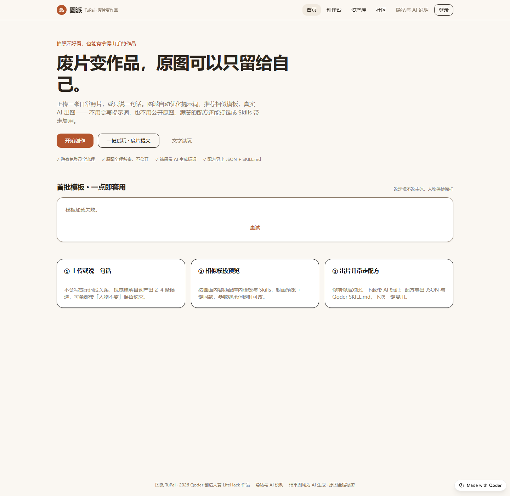
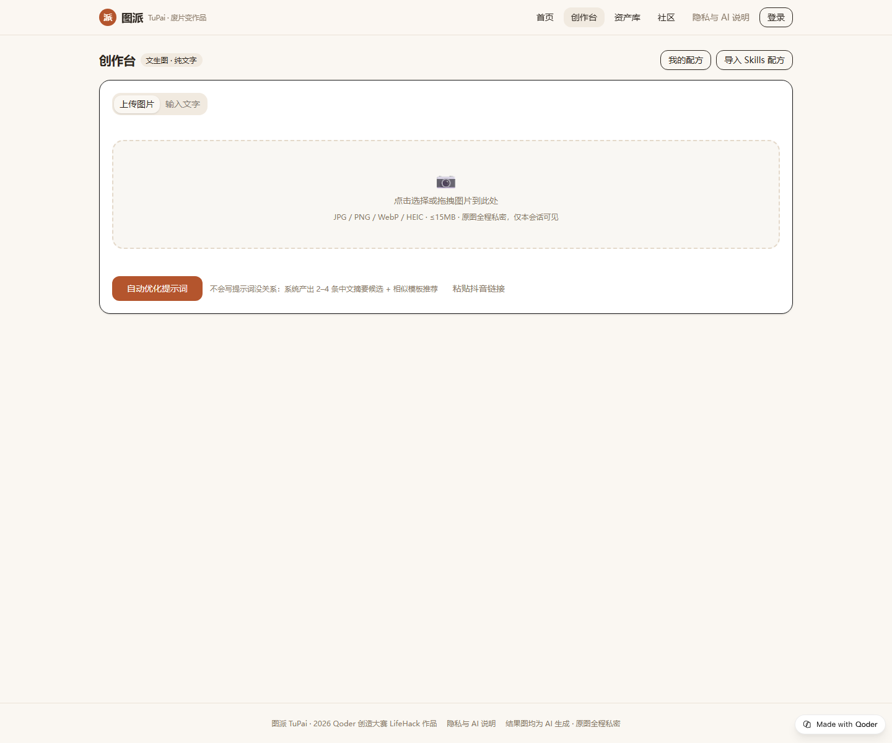
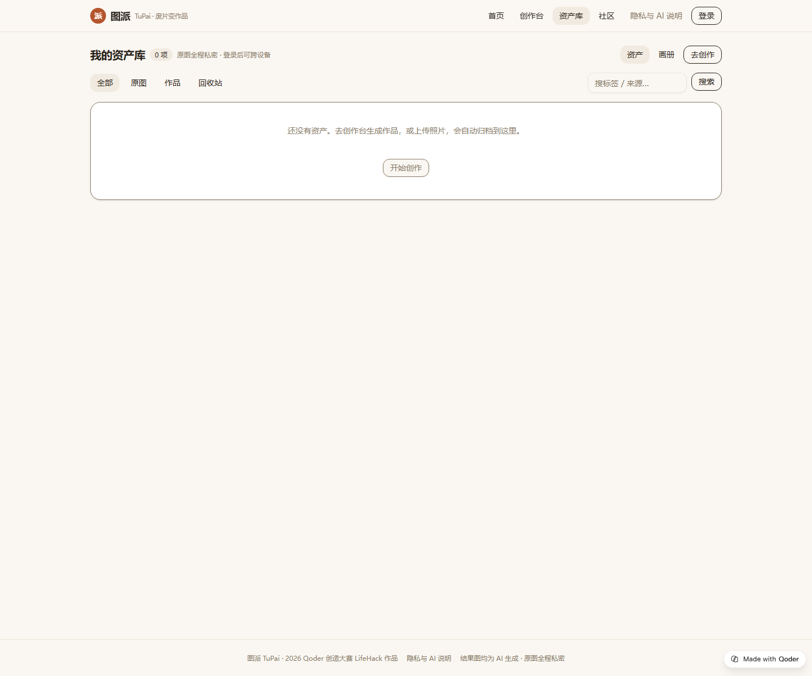
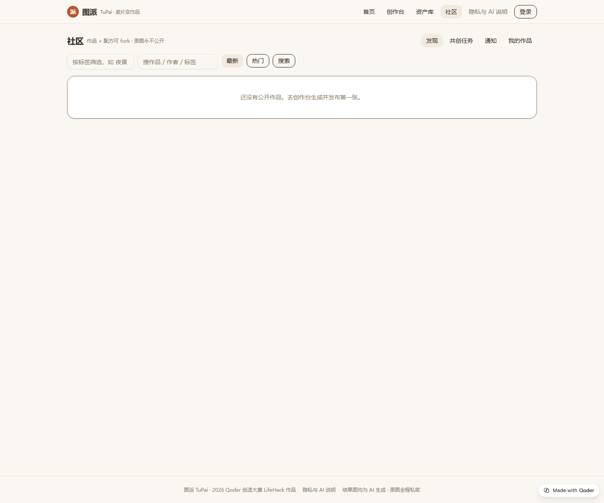

# 图派 TuPai

> 让拍照不好看的人，也能有别样的作品去发布——可以不发原图。

2026 Qoder 高校创造力大赛 · LifeHack 赛道参赛作品。代码全程用 Qoder 开发，前端、云函数、数据库、存储与 Secret 部署在 Qoder Sites。

**线上体验**：<https://tupai-moo3r9zpvox.qoder.zone>（public，游客免登录）
**一键试玩**：<https://tupai-moo3r9zpvox.qoder.zone/studio/?demo=night&template=night-bright>

| 首页 | 创作台 | 资产库 | 社区 |
|---|---|---|---|
|  |  |  |  |

## 这是什么

图派把「日常废片」变成愿意发出去的作品：上传一张照片或说一句话，系统自动理解画面、生成可编辑的提示词候选，并推荐相似模板；用户微调模型/画幅后异步生成，修前修后对比，下载带「AI 生成」标识的成品。

三条产品底线：

- **原图可留私**：original 全程 private，视觉分析与图生图均 base64 直传，不落公网；发布/画册只触及 result。
- **配方可带走**：作品可导出 `tupai-skill` JSON 与 Qoder `SKILL.md`，也可导入回填、保存进「我的配方」。
- **结果可追溯**：结果图与下载物强制带 AI 标识；社区 fork 只继承配方快照，不携带他人底图。

## 功能概览

| 模块 | 能做什么 |
|---|---|
| 首页 | 暖纸编辑风、显影对比、5 个日常向模板、一键试玩、模板大图预览 |
| 创作台 | 图片/文字/抖音图文链接三入口；自动优化 2–4 条候选（中文摘要）；相似模板/Skills 推荐；夜景雨夜霓虹、旅行复古明信片变体；模型/画幅切换；异步生成；修前修后对比；AI 标识下载；Skills 双导出/导入；刷新恢复上次任务；今日剩余额度 |
| 资产库 | Qoder 登录/游客数据绑定；归档、标签检索、详情、回收站软删/恢复；画册 CRUD；只读分享链接与自包含翻页页 |
| 社区 | 发布审核、发现页、作品页、一键 fork（纯文字也可）、lineage 署名、点赞/评论/作者折叠、共创任务、通知、举报下架/申诉、撤回/重发、数据导出、注销真删 |
| 隐私与合规 | 原图私密、结果 AI 标识、第三方 COS 链接不直出、Key 只存 Sites Secret |

## 技术栈

| 层 | 选择 |
|---|---|
| 前端 | React 19 + TypeScript + Vite 8 + Tailwind CSS 4 + shadcn/ui |
| 后端 | Deno 云函数（Sites `app` Function，路由薄层） |
| 契约 | OpenAPI 3.1：45 路径 / 57 操作 / 47 schema，一期 `contract-test` + 二三期 `contract-test-extended` |
| 数据 | Qoder Sites 数据库（14 表）+ 对象存储（原图私有 / 结果转存） |
| AI | Agnes 免费模型：`agnes-image-2.5-flash` / `agnes-image-2.1-flash` 出图，`agnes-3.0-flash` 视觉理解与提示词优化 |
| 部署 | Qoder Sites 静态站点 + 云函数 + Secret；访问策略 public |

## 目录结构

```text
LifeHack·图派/                     # git 根
├─ README.md / LICENSE
├─ docs/                           # 01–11 项目文档
├─ 代码仓库/
│  ├─ web/                         # React SPA；public/ 是运行时派生副本
│  ├─ server/                      # Deno 云函数（routes/agnes/auth/seed/validate）
│  ├─ api/                         # openapi.yaml + schema*.sql + mock + 契约测试
│  ├─ dev/                         # 本地 fake、回归与验收脚本
│  └─ .图派.qoder.site             # 发布元数据（真实 ID，勿手写）
├─ 资产仓库/                        # ★ 唯一资产源
│  ├─ 总索引.md
│  ├─ brand/                       # Logo 唯一源 + 品牌规范
│  ├─ designs/                     # 页面版本、设计系统、参考与归档
│  ├─ templates/<template-id>/     # 清单 + 提示词 + 封面 + 封面原图
│  ├─ media/{generated,licensed,derived,private}/
│  ├─ skills/{own,third-party}/
│  ├─ manifests/{资产清单.json,运行时映射.json}
│  └─ archive/
├─ 早期规划/                        # 历史资料，本地只读，不入库
└─ .workbuddy/                     # 本地工具状态，不入库
```

> 本地私有文件：`AGENTS.md`、`.gitignore` 保留在工作区，不随 GitHub 发布；公开边界以 [docs/11](docs/11-提交范围与边界.md) 为准。

## 快速开始

要求：Node.js 24+、Deno 2+。本地开发无需任何真实 Agnes Key（无凭证时自动走 Mock）。

```bash
# 1. 前端（Vite :5173，proxy → :8000）
cd 代码仓库/web && npm install && npm run dev

# 2. 后端（无凭证 fake，Mock 兜底）
cd 代码仓库 && deno run --allow-net=127.0.0.1:8000 --allow-read dev/function-local.ts

# 3. 构建
cd 代码仓库/web && npm run build
```

公网深链使用尾斜杠（如 `/studio/`、`/library/`）；应用内导航已统一写入尾斜杠地址。

### 验证脚本

| 命令 | 覆盖 |
|---|---|
| `node 代码仓库/api/contract-test.mjs` | 一期契约 35 断言（可传云端 BASE） |
| `node 代码仓库/api/contract-test-extended.mjs` | 二三期契约 49 断言（本地身份夹具） |
| `node 代码仓库/dev/community-test.mjs` | 社区全链 23 断言 |
| `node 代码仓库/dev/failpath-test.mjs` | 故障注入 20 断言 |
| `node 代码仓库/dev/mobile-test.mjs` | 移动视口 50 断言（需 Playwright） |
| `node 代码仓库/dev/interaction-verify.mjs` | 交互补核 10 断言 |
| `node 代码仓库/dev/regression-tab-reset.mjs` | 切标签/重开回归 6 断言 |
| `node 代码仓库/dev/heic-verify.mjs` | HEIC 转换（设置 `HEIC_FIXTURE` 覆盖成功路径） |
| `node 代码仓库/dev/cloud-acceptance.mjs` | 云端真实出图验收 22 断言（发布后） |
| `node 代码仓库/dev/demo-rehearsal.mjs` | 60 秒演示路径计时 |
| `node 代码仓库/dev/repo-scope-check.mjs` | 仓库提交范围与边界检查 |

## 仓库范围与提交边界

这里定义**什么该进 GitHub、什么只留本地**。完整规则见 [docs/11-提交范围与边界](docs/11-提交范围与边界.md)；本地 `AGENTS.md` 与 `.gitignore` 不随仓库发布。

### 必须提交（产品与唯一源）

- 根约定：`README.md`、`LICENSE`
- 文档：`docs/01`–`docs/11`
- 可运行产品：`代码仓库/web/`（含 `public/` 运行时资源）、`server/`、`api/`、`dev/`、`.图派.qoder.site`
- 资产源：`资产仓库/总索引.md`、`brand/logo/`、`brand/品牌规范.md`、`templates/<id>/{清单.json,提示词.md,封面.webp}`、`media/{licensed,generated,derived}/`、`manifests/`、`designs/pages/*/索引.md`、版本说明与系统提示词、`skills/third-party/`

### 按需提交（过程证据，只留代表）

- 可交互原型：`designs/pages/home/v02.../index.html`、`画廊演示.html`、`设计方案.md`
- 每页保留 1 张定稿预览；三方案对比 `explorations/` 保留
- 模板回归样片（`samples/`）在确有样片时提交，不伪造空目录

### 不提交（本地保留）

- 秘密与私图：`.env*`、Key、`docs/references/agnes-api.md`、`资产仓库/test-images/`、`media/private/`、用户真实废片
- 依赖与产物：`node_modules/`、`dist/`、`.vite/`、`*.tsbuildinfo`
- 本地工具状态：`.workbuddy/`、浏览器缓存、临时截图与日志
- 新增的过程产物：`designs/**/assets/` 原型自包含副本、`media/generated/brand-explorations/`、`designs/archive/` 新增归档、批量预览截图

> **历史原则**：已推送的 Git 历史不重写、不强推；已跟踪的过程产物保留在历史中，**本轮不做 `git rm --cached` 清理**。如需精简，按 [docs/11](docs/11-提交范围与边界.md) §5 单独评审，并以新提交处理。

### 新资产判定顺序

1. 先查 `资产仓库/manifests/资产清单.json` 的 sha256：命中则复用，禁止散复制。
2. 需要派生 → 放 `media/derived/`，记录 `derivative_of`，不覆盖源图。
3. 需要新生成 → 先落 `资产仓库/`，再同步 `web/public/`，最后更新 `manifests/运行时映射.json`。
4. 命名：**资产文件中文、技术标识英文**；`public/` 路径永远英文。

### 提交前检查

```bash
node 代码仓库/dev/repo-scope-check.mjs   # 禁止路径 / 未知顶层 / 超大文件 / 重复图片
git status --short                       # 应干净
git diff --cached --stat                 # 确认批次范围
git add -- <明确路径>                     # 禁止 git add -A
```

- **提交标题使用中文**：`中文类型(范围): 中文摘要`，如 `修复(资产): 修正清单引用`；禁止 `fix/docs/feat` 等英文类型前缀。2026-11-18 已将 44 条历史提交标题一次性改为中文（文件树未变）。
- 本地 `AGENTS.md` 与 `.gitignore` 不提交；它们通过 `.git/info/exclude` 排除。

## 文档索引

**必读**

| 文档 | 回答什么 |
|---|---|
| [01-需求文档](docs/01-需求文档.md) | 做什么：定位、三期路线、功能与验收 |
| [02-开发文档](docs/02-开发文档.md) | 怎么做：架构、数据模型、关键设计、WBS |
| [04-资产与数据](docs/04-资产与数据.md) | 资产目录、来源、协议、运行时映射 |
| [05-注意事项](docs/05-注意事项.md) | 安全、隐私、协议、工程与赛务红线 |
| [06-参赛交付](docs/06-参赛交付.md) | 赛规、时间线、演示脚本、发布与验收记录 |
| [07-接口契约](docs/07-接口契约.md) | API v1/v1.1 契约摘要与增量端点 |
| [11-提交范围与边界](docs/11-提交范围与边界.md) | GitHub 上传范围、禁止清单、大文件与检查流程 |

**参考**

| 文档 | 回答什么 |
|---|---|
| [03-Agnes接入](docs/03-Agnes接入.md) | 出图/反推 API 接入与实测清单 |
| [08-调研参考](docs/08-调研参考.md) | 玩法、Skills 原料、数据集与设计参考 |
| [09-统一重构方案](docs/09-统一重构方案与文件清单.md) | 三页结构重构方案与实施记录 |
| [10-资产治理执行Prompt](docs/10-下一阶段资产治理与页面迭代执行Prompt.md) | 上一轮资产治理执行约束（历史） |

## 当前状态

- **线上版本**：2026-11-18 已发布（public），首页与 `/studio/`、`/library/`、`/community/`、`/legal/` 均 200，真实 Agnes 出图生效。
- **已完成**：一期创作闭环；二期登录绑定/资产库/回收站/画册分享/链接解析；三期发布审核/发现/fork/互动/共创任务/举报申诉/导出注销。
- **未实现**：P2-F4 对话检索、P2-F9 批量管理、P2-F10 存储配额、画册 zip 导出/子路径部署。
- **验证**：build 通过；契约 35/35；扩展契约 49/49；社区 23/23；故障 20/20；真实出图验收 22/22；详细记录见 [06 §7](docs/06-参赛交付.md)。
- **截止**：2026-11-30 18:00。

## License

MIT（第三方材料各自协议，见 [LICENSE](LICENSE)）。Key 仅存 Sites Secret（`AGNES_KEYS_CN` / `AGNES_KEYS_INTL`），仓库与站点零 Key。
