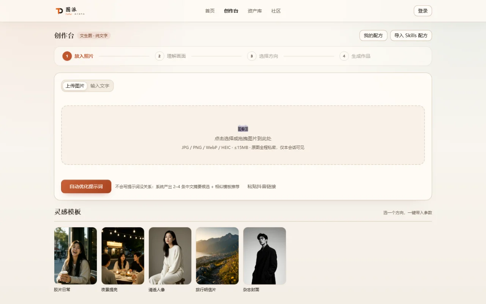
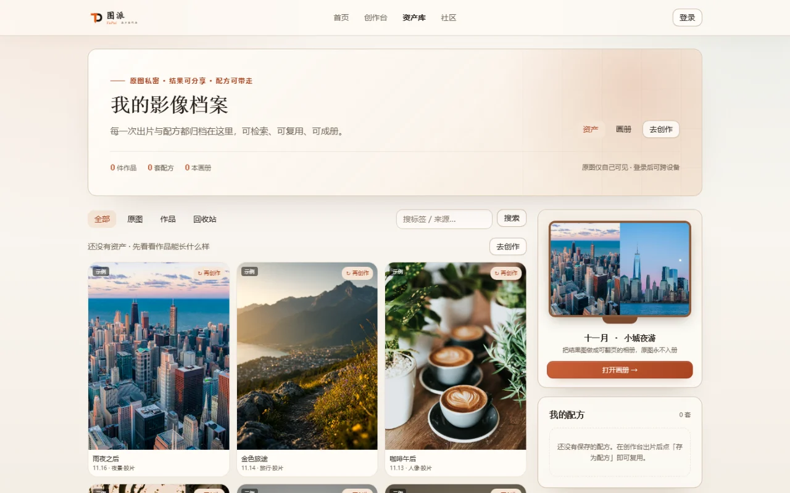

<p align="center"></p>

<p align="center">把不好看的照片，变成可以发布的作品——原图不必公开。</p>

<p align="center"><a href="https://tupai-moo3r9zpvox.qoder.zone"></a>  </p>

<table>
<tr>
<td width="50%"><br><sub><b>首页</b> · 无限画廊与显影对比</sub></td>
<td width="50%"><br><sub><b>创作台</b> · 五阶段生成闭环</sub></td>
</tr>
<tr>
<td><br><sub><b>资产库</b> · 影像档案与画册</sub></td>
<td><br><sub><b>社区</b> · 作品墙与共创</sub></td>
</tr>
</table>

## 这是什么

拍得不好看的照片，大多只能躺在相册里。图派先理解画面，再把「怎么改」写成可复用的配方，一键生成可以发布的作品。

**原图默认私密**：原图保存在私有存储，视觉分析和图生图时以 base64 传给 Agnes；发布与画册只接受生成结果。**配方可带走**：可导出 JSON 与 `SKILL.md`，也可重新导入。**结果可追溯**：创作台展示 AI 角标，下载时合成标识；社区与画册的图片标识和完整署名链仍有缺口，见[核对记录](docs/12-文档与代码核对.md)。

## 功能

- **创作闭环** — 图片或文字入口 → 自动优化提示词 → 候选方向 → 异步生成 → 修前修后对比 → 带 AI 标识下载
- **资产库与画册** — 原图/作品归档检索、回收站软删恢复、只读翻页画册；自动到期清理和 zip 导出尚未实现
- **社区** — 发布、发现、fork、评论点赞、共创任务、通知、举报、自动申诉复审与撤回；审核降级、公开图片标识和完整署名链仍有缺口
- **链接导入** — 尽力解析抖音单条图文；导入图片继续创作时会作为私有原图保存，用后即焚尚未实现
- **Skills 双导出** — 配方导出为 JSON 与 SKILL.md，支持导入回填与站内配方

## 快速开始

要求 Node.js 24+ 与 Deno 2+。新克隆先检查 `.gitignore.example`，按需复制或合并为本地 `.gitignore`，已有文件不要覆盖。

```bash
# 前端（Vite :5173，代理 /functions/v1/app 到 :8000）
cd 代码仓库/web
npm ci
npm run dev

# 另开终端：无凭证本地 fake 后端
cd 代码仓库
deno run --allow-net=127.0.0.1:8000 --allow-read dev/function-local.ts
```

未配置 Agnes Key 时走 Mock。`web/package.json` 中指向 `web/dev` 与 `web/functions` 的旧脚本未随实际目录更新，本地联调请使用上面的根路径命令。

## 验证

```bash
cd 代码仓库/web
npm run build

cd ..
node api/contract-test.mjs
node api/contract-test-extended.mjs
node dev/community-test.mjs
node dev/repo-scope-check.mjs
node dev/repo-scope-check-test.mjs
```

契约、社区和浏览器脚本需先启动匹配的本地服务；云端验收脚本会访问真实站点。提交范围检查读取 Git 暂存内容，不能替代敏感值审查。

## 技术栈

React 19 · Vite 8 · Tailwind 4 · Deno · Qoder Sites · OpenAPI · Agnes

## 文档

| 入口 | 内容 |
|---|---|
| [需求文档](docs/01-需求文档.md) | 定位、三期路线、功能与验收目标 |
| [开发文档](docs/02-开发文档.md) | 架构、数据模型、关键设计与实施记录 |
| [资产与数据](docs/04-资产与数据.md) | 唯一资产源、来源、协议与运行时映射 |
| [注意事项](docs/05-注意事项.md) | 安全、隐私、协议与赛务红线 |
| [参赛交付](docs/06-参赛交付.md) | 赛规、演示脚本、历史验证与部署记录 |
| [接口契约](docs/07-接口契约.md) | API 摘要；完整定义以 `openapi.yaml` 为准 |
| [提交边界](docs/11-提交范围与边界.md) | 公开范围、本地保留与检查流程 |
| [文档与代码核对](docs/12-文档与代码核对.md) | 已核实的实现差异、风险与待办 |

## 当前状态

线上地址与历史发布 ID 见 [参赛交付记录](docs/06-参赛交付.md)。本次代码和文档修订是否上线以实际部署记录为准。截止日期为 2026-11-30 18:00。

## License

MIT；第三方素材与代码遵循各自许可，详见 [LICENSE](LICENSE) 与资产来源记录。Key 仅存 Sites Secret。