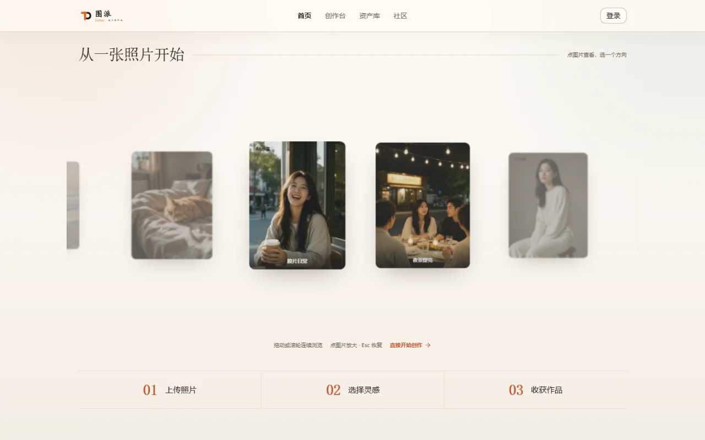
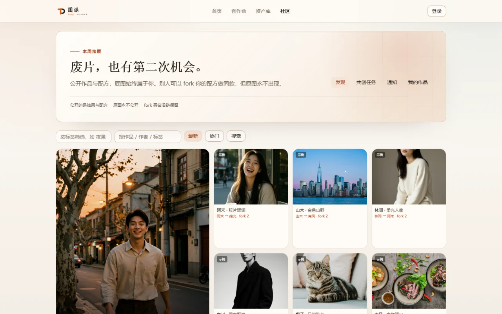

<p align="center"></p>

<p align="center">把不好看的照片，变成可以发布的作品——原图不必公开。</p>

<p align="center"><a href="https://tupai-moo3r9zpvox.qoder.zone"></a>  </p>

<table>
<tr>
<td width="50%"><br><sub><b>首页</b> · 无限画廊与显影对比</sub></td>
<td width="50%"><br><sub><b>创作台</b> · 五阶段生成闭环</sub></td>
</tr>
<tr>
<td><br><sub><b>资产库</b> · 影像档案与画册</sub></td>
<td><br><sub><b>社区</b> · 作品墙与共创</sub></td>
</tr>
</table>

## 这是什么

拍得不好看的照片，大多只能躺在相册里。图派先理解画面，再把「怎么改」写成可复用的配方，一键生成能直接发布的作品。

三条差异：**原图全程私密**（不进公共存储）、**配方可带走**（JSON + SKILL.md 双导出）、**结果强制带 AI 标识**。

## 功能

- **创作闭环** — 图片或文字入口 → 自动优化提示词 → 候选方向 → 异步生成 → 修前修后对比 → 带 AI 标识下载
- **资产库与画册** — 原图/作品归档检索、回收站、可翻页画册与只读分享链接
- **社区 fork** — 公开作品与配方可 fork 做同款，署名沿链保留，举报/申诉/撤回齐全
- **Skills 双导出** — 配方导出成 JSON 与 SKILL.md，可导入回填复用

## 快速开始

```bash
cd 代码仓库/web && npm install && npm run dev    # 前端 http://127.0.0.1:5173
cd 代码仓库 && deno run --allow-net=127.0.0.1:8000 --allow-read dev/function-local.ts   # 本地 fake 后端
node 代码仓库/api/contract-test.mjs              # 契约测试 35 断言
```

没有配置任何 Key 也能完整跑通：后端检测到 Key 池为空会自动走 Mock 兜底，前端表现与真实环境一致。

## 技术栈

React 19 · Vite 8 · Tailwind 4 · Deno · Qoder Sites · OpenAPI · Agnes

## 文档

| 入口 | 内容 |
|---|---|
| [需求文档](docs/01-需求文档.md) | 定位、三期路线、功能与验收 |
| [参赛交付](docs/06-参赛交付.md) | 赛规、演示脚本、验证与部署记录 |
| [接口契约](docs/07-接口契约.md) | API 契约、错误信封、mock 约定 |
| [提交边界](docs/11-提交范围与边界.md) | 什么进仓库、命名规则与协作方式 |
